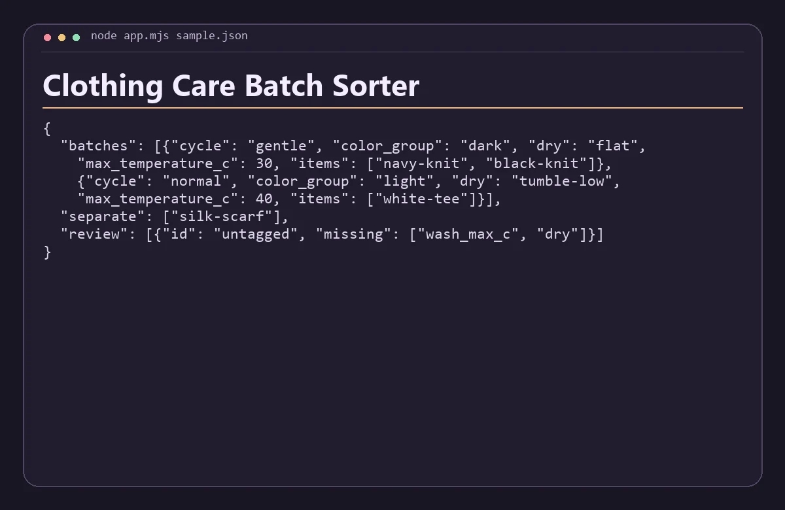

# Clothing Care Batch Sorter

Group garments by the machine-wash, color, and drying instructions you enter and flag labels that need review.



## Run

Install Node.js 22 or newer. Run these commands from the repository root.

```sh
node app.mjs sample.json
```

Replace `sample.json` with a JSON file following the same structure. The app prints a JSON report to standard output.

Transcribe each garment label and choose a color group, including separate groups for items that may bleed. Batches use exact matches on cycle, color group, and drying method. The maximum washing temperature is the lowest recorded limit in each batch. Non-machine-wash items are listed separately. Missing labels are flagged for review.

## Verify

Run `python check.py` with Python 3.11 or newer after the build step when applicable. The check verifies the bundled scenario and confirms that an invalid input returns an error.
